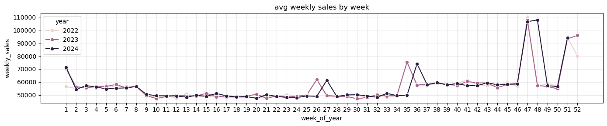
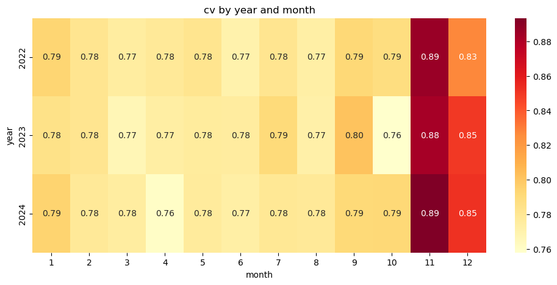
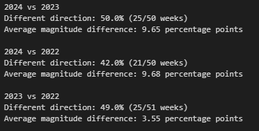
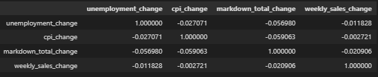

# 🧪 Building a Reliable Retail Sales Forecasting Model 
*insert model image here*

## 🧠 About this Project 
This project is all about demonstrating my end-to-end data science process, with a key focus on building a machine learning model that can reliably forecast future retail sales.
  
This .readme document will take you through my **journey of decision making in building out the final model** 

Think of this as a walkthrough of not just *what* I built, but also *why* I made certain decisions along the way.

## 🎯 Objectives of this Project
Retail businesses often deal with challenges when it comes to operationally preparing and predicting consumer demand for seasonal sales throughout the entire year -- affecting their inventory planning, staffing allocation and just the overall mental stress of uncertainty. 

Using a company's historical sales data -- a machine learning model can be built that can help predict their future sales in anticapation of these demands.

This project aims to:
1. **Predict future sales:** Build a machine learning model that can forecast a retailer's total weekly sales up to 12 weeks (roughly 3 months) ahead.
   
2. **Uncover the key patterns:** Dig into the numbers, uncover interesting sales patterns, and understand what factors might be driving weekly sales.

3. **Find the champion model:** Experiment with different algorithms, compare their predictive performance, and identify which model does the best job of forecasting future sales.

## 2. Retail Dataset 
Source: https://www.kaggle.com/datasets/noopurbhatt/retail-store-sales-forecasting-dataset

3 datasets
- sales.csv
- stores.csv
- features.csv

Data period: Jan 2022 - Dec 2024

## 3. Methodology 

Before anything, how do I determine if my model's predictive power is even reliable for of this project? 
### 💯 The Success Metrics

I wanted to establish what success would look like before getting carried away with model building and chasing better scores. So, I set a few **minimum** performance requirements that the model would need to meet on unseen data (a.k.a. the test set):

(a) **Overall Forecasting Error:** WAPE below 5%, meaning the model's overall prediction errors are relatively small compared to actual sales.

(b) **Prediction Consistency:** At least 80% of weekly predictions should fall within ±5% of actual sales. *No point in having a model that's great at predicting some weeks but misses the mark on most others!*

(c) **Explained Variation:** An R² of at least 0.85, meaning the model can explain 85% of the variation in weekly sales.

The idea is not just to produce good-looking metrics, but actually provides reliable output that the business can use to plan resources better

### 🧭 The Approach

As for my approach, rather than going directly into data modelling and start jamming in features and algorithms. I broke down my project into structured step-by-step stages (as seen on my jupyter notebook), with each stage building upon the next. Each stage having it's own specific purpose on building the model's quality, reliability and predictive power... and ofcourse a well-documented journey makes things easier to backtrack!

Most of my time spent being operating in the mindset of curiosity with these 2 simple questions *"What are the existing weekly sales patterns I can observe from the data that best explain weekly sales variation through time? And how can I translate these findings as predictive signals for the model to learn from?"*... This meant rounds of **data discovery -> experimentation -> feature rationalization** and back to discovery to repeat the cycle. Because good models are built from finding the right materials, then constantly experimenting!  

## 5. Key Findings for Predictive Signals (EDA)

### How is weekly sales data shaped?

Three (3) patterns can be said based on my findings on the 'shape' of 
1. Most weeks have similar sales levels, but a few weeks stand out with much higher sales. This suggests that certain periods bring noticeable spikes in customer demand.

2. Weekly sales tend to follow a recurring pattern across the years, suggesting that demand is influenced by seasonality.

3. While the pattern is the same, the timing and direction of some sales spikes differ in 2024 compared to the previous two years, suggesting that seasonal patterns don't always repeat exactly the same. This suggests that certain periods bring noticeable spikes in customer demand. 

**Sales Distribution**

**Sales Across the Years**

**Overlaying the Weekly Sales by Year**

### How volatile are sales between periods?

The variance/spread in sales remains fairly stable from January to October (CV of 0.76–0.80), but rises noticeably in November and December (CV of 0.83-0.89), suggesting stronger and less predictable sales fluctuations during the holiday season.

- *Note: Coefficient of Variance (CV) helps measure sales fluctations relative to their average value, and is expressed in percentage. A CV of 1.0 (100%) indicates very high variability, meaning the values spread are as large as the average itself! If average weekly sales are 10M, a CV of 1.0 is also 10M away from the average.*

**Variability by Quarter & Month for each year**

### How often does weekly sales direction and momentum differ from across years?

If sales direction and momentum are similar across years it would be much easier to create a predictive signal, as we can just look at the week numbers vs. last year as the north star of prediction! But as shown earlier, spike and timing differ across the years just by overlaying the 3 years. So seasonal patterns dont repeat exactly at the same time. 

The question I wanted to ask next was: ***just how different are these weeks?*** 

To put some numbers behind what I was seeing, I compared how often weekly sales direction differed across 2022, 2023, and 2024.

And here's the interesting part: sales direction differs in roughly half of comparable weeks across years! In other words, while the bigger seasonal patterns may look familiar, the week-to-week ride can be a very different story each year.

**Comparison of Weekly Sales Momentum per year**

### How do holidays impact weekly sales?

These patterns can be said on the impact of holidays to avg. weekly sales:
1. Across any kind of holiday that is occuring, the sales are always atleast 50% larger than a non-holiday. And the particular holiday differs in avg. weekly sales, for example Black Friday across all years always contribute the largest sales, while Independence day is the least.
   
2. While each year may have the same number and type of holiday. 2024 vs. both 2023 and 2022 follow a different holiday duration. What i mean is Black Friday spans two weeks in 2024, while Christmas spans two weeks in 2022 and 2023 but only one week in 2024. This duration was seen to show the pattern that seasonal weekly sales patterns differ YoY

**Holiday vs. Non-Holiday Avg. Weekly Sales (Year)**

**Count of Holidays per Year**

**Sales Impact by Holiday Name (Year)**

### How do changes in factors like unemployment, cpi and promotional markdowns affect weekly sales changes?

Other factors like the changes in unemployment, cpi and promotional markdowns through time surprisiginly didn't have a significant effect on the changes to sales in between week periods. 

Below shows a pearson correlation matrix of weekly sales change vs. changes in these factors. Results imply that there's a very weak correlation to changes in these factors vs. changes in weekly sales. (less than >)

*Note: A person correlation matrix measures the strength between 2 variables, with values ranging from -1 to 1. The closer it is to -1 or 1 implies a strong relationship between the variables. A statistic of 0.05 implies a very weak relationship -- note that correlation is different from causation*

**Pearson Correlation Matrix**

## 6. Key Feature Candidates
-These are the features I used for the final ML Model. Later on it i'll go what didn't work

## 7. Model Train-Test Split for Forecasting
- Leakage prevetion
- 80/20 split and strategy

## 8. Model Experimentation & Results
** What worked (80%) and didn't work (20%)
- Model A: Linear Regression
- Model B: XGBoost
- Model Comparison

## 9. Champion Model: Feature Importance
- Interpretation

## 10. Champion Model: Residual Analysis
- Reveal struggles in model

## 11. Business Interpretation and Insights
- These are the patterns i discovered in the data
- Why these features were important
- asdasd
