# 🧪 Building a Reliable Retail Sales Forecasting Model 
*insert model image here*

## 🧠 About this Project 
This project is all about demonstrating my end-to-end data science process, with a key focus on building a machine learning model that can reliably forecast future retail sales.
  
This .readme document will take you through my **journey of decision making in building out the final model** 

Think of this as a walkthrough of not just *what* I built, but also *why* I made certain decisions along the way.

## 🎯 Objectives of this Project
Retail businesses often deal with challenges when it comes to operationally preparing and predicting consumer demand for seasonal sales throughout the entire year -- affecting their inventory planning, staffing allocation and just the overall mental stress of uncertainty. 

Using a company's historical sales data -- a machine learning model can be built that can help predict their future sales in anticapation of these demands.

This project aims to:
1. **Predict future sales:** Build a machine learning model that can forecast a retailer's total weekly sales up to 12 weeks (roughly 3 months) ahead.
   
2. **Uncover the key patterns:** Dig into the numbers, uncover interesting sales patterns, and understand what factors might be driving weekly sales.

3. **Find the champion model:** Experiment with different algorithms, compare their predictive performance, and identify which model does the best job of forecasting future sales.

## 2. Retail Dataset 
Source: https://www.kaggle.com/datasets/noopurbhatt/retail-store-sales-forecasting-dataset

3 datasets
- sales.csv
- stores.csv
- features.csv

Data period: Jan 2022 - Dec 2024

## 3. Methodology 

Before anything, how do I determine if my model's predictive power is even reliable for of this project? 
### 💯 The Success Metrics

I wanted to establish what success would look like before getting carried away with model building and chasing better scores. So, I set a few **minimum** performance requirements that the model would need to meet on unseen data (a.k.a. the test set):

(a) **Overall Forecasting Error:** WAPE below 5%, meaning the model's overall prediction errors are relatively small compared to actual sales.

(b) **Prediction Consistency:** At least 80% of weekly predictions should fall within ±5% of actual sales. *No point in having a model that's great at predicting some weeks but misses the mark on most others!*

(c) **Explained Variation:** An R² of at least 0.85, meaning the model can explain 85% of the variation in weekly sales.

The idea is not just to produce good-looking metrics, but actually provides reliable output that the business can use to plan resources better

### 🧭 The Approach

As for my approach, rather than going directly into data modelling and start jamming in features and algorithms. I broke down my project into structured step-by-step stages (as seen on my jupyter notebook), with each stage building upon the next. Each stage having it's own specific purpose on building the model's quality, reliability and predictive power... and ofcourse a well-documented journey makes things easier to backtrack!

Most of my time spent being operating in the mindset of curiosity with these 2 simple questions *"What are the existing weekly sales patterns I can observe from the data that best explain weekly sales variation through time? And how can I translate these findings as predictive signals for the model to learn from?"*... This meant rounds of **data discovery -> experimentation -> feature rationalization** and back to discovery to repeat the cycle. Because good models are built from finding the right materials, then constantly experimenting!  


## 5. Key Findings for Predictive Signals (EDA)

### How is weekly sales data shaped?

Three (3) patterns can be said based on my findings on the 'shape' of 
1. Most weeks have similar sales levels, but a few weeks stand out with much higher sales. This suggests that certain periods bring noticeable spikes in customer demand.

2. Weekly sales tend to follow a recurring pattern across the years -- always starting Q1 at baseline, then small decline but stable with small fluctations thorughout Q2-Q3 and rising towards Q4. Suggesting a recurring seasonality

3. While the pattern is the same, when years are overlayed - the timing and direction of some sales spikes differ in 2024 compared to the previous two years, suggesting that seasonal patterns don't always repeat exactly the same. This suggests that certain periods bring noticeable spikes in customer demand. 

**Sales Distribution**
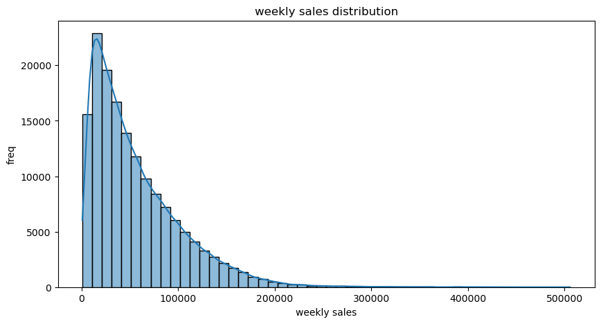

**Sales Across the Years**
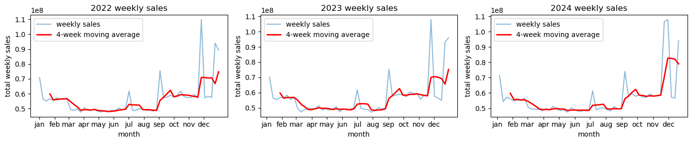

**Overlaying the Weekly Sales by Year**


### How volatile are sales between periods?

The variance/spread in sales remains relatively high but fairly stable from January to October (CV of 0.76–0.80), but rises noticeably in November and December (CV of 0.83-0.89). This suggests that sales become more volatile during the holiday season.

- *Note: Coefficient of Variance (CV) helps measure sales fluctations relative to their average value, and is expressed in percentage. A CV of 1.0 (100%) indicates very high variability, meaning the values spread are as large as the average itself! If average weekly sales are 10M, a CV of 1.0 is also 10M away from the average.*

**Variability by Quarter & Month for each year**
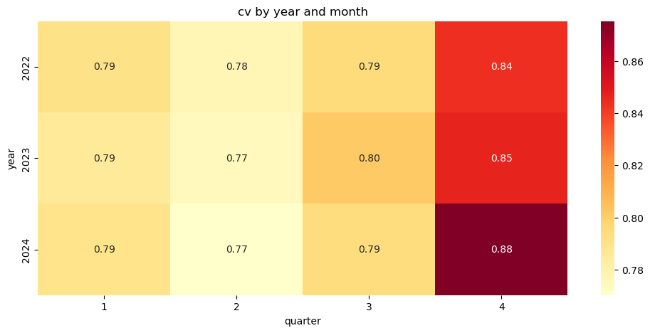


### How often does weekly sales direction and momentum differ from across years?

If sales direction and momentum are similar across years it would be much easier to create a predictive signal, as we can just look at the week numbers vs. last year as the north star of prediction! But as shown earlier, spike and timing differ across the years just by overlaying the 3 years. So seasonal patterns dont repeat exactly at the same time. 

The question I wanted to ask next was: ***just how different are these weeks?*** 

To put some numbers behind what I was seeing, I compared how often weekly sales direction differed across 2022, 2023, and 2024.

And here's the interesting part: sales direction differs in roughly half of comparable weeks across years! In other words, while the bigger seasonal patterns may look familiar, the week-to-week ride can be a very different story each year.

**Comparison of Weekly Sales Momentum per year**
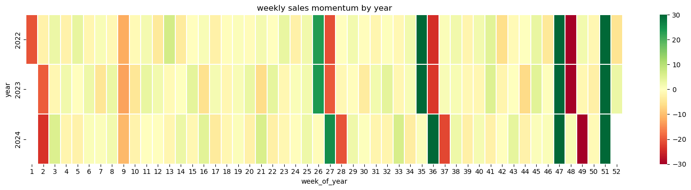


### How do holidays impact weekly sales?

These patterns can be said on the impact of holidays to avg. weekly sales:
1. Across any kind of holiday that is occuring, the sales are always atleast 50% larger than a non-holiday. And the particular holiday differs in avg. weekly sales, for example Black Friday across all years always contribute the largest sales, while Independence day is the least.
   
2. While each year may have the same number and type of holiday. 2024 vs. both 2023 and 2022 follow a different holiday duration. What i mean is Black Friday spans two weeks in 2024, but one week in 2023 and 2022.... while Christmas spans two weeks in 2022 and 2023 but only one week in 2024. This holiday duration is a factor of differing sales patterns YoY

**Holiday vs. Non-Holiday Avg. Weekly Sales (Year)**
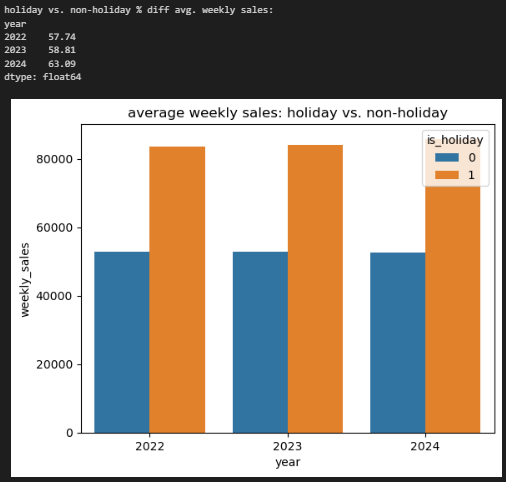

**Count of Holidays per Year**
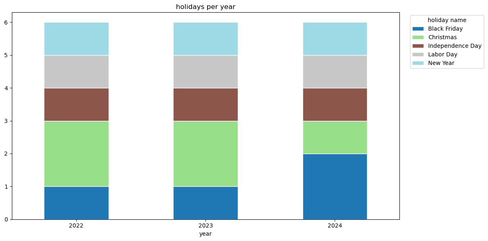

**Sales Impact by Holiday Name (Year)**
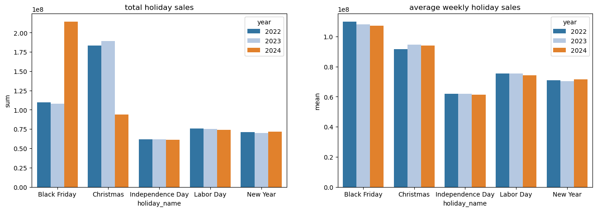

### How do changes in factors like temperature, unemployment, cpi and promotional markdowns affect weekly sales changes?

Other factors, such as changes in unemployment, CPI, and promotional markdowns, surprisingly showed little relationship with week-to-week sales changes. Temperature was the exception, showing a slightly stronger correlation.

The Pearson correlation matrix below shows very weak correlations between weekly sales changes and most of these factors (around ±0.03), while temperature changes showed a somewhat stronger relationship (around ±0.07).

*Note: A person correlation matrix measures the strength between 2 variables, with values ranging from -1 to 1. The closer it is to -1 or 1 implies a strong relationship between the variables. A statistic of 0.05 implies a very weak relationship -- note that correlation is different from causation*

**Pearson Correlation Matrix**


*A flat horizontal red line signifies a weak correlation*
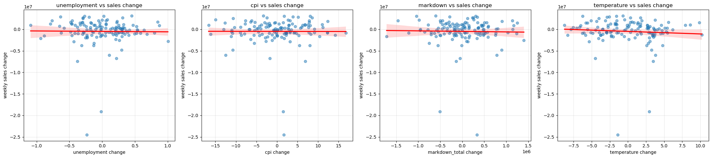


## 6. Key Feature Candidates
Gathering all my insights, I produced 20 total different features and I've decided to group my predictive signals(features) candidates into these 5 different groupings based on purpose:

Ultimately, these were the final features used on the model after several experimentations. 

Later, in the ***Model Experimentation & Results*** section, I'll revisit some of the features that didn't make the final cut, and infer what made them worsed the model.

*Note: `holiday_name` was converted into 5 separate binary features using a method called **one-hot encoding**, with each feature representing a different holiday. For example, `holiday_Christmas` is assigned a value of 1 or 0 depending on whether the week corresponds to Christmas.*

| Feature Group | Features |
|---|---|
| **Historical Lags & Rolling Statistics** | `sales_lag_1`, `sales_lag_2`, `sales_lag_3`, `sales_lag_4`, `rolling_mean_4`, `rolling_std_4`, `rolling_max_4` |
| **Seasonality** | `week_sin`, `week_cos` |
| **Directional & Momentum Shifts** | `lag1_week_sin`, `lag1_week_cos`, `momentum_week_sin`, `momentum_week_cos` |
| **Holiday Indicators** | `is_holiday`, `holiday_name` *(one-hot encoded)* |
| **Others** | `temperature` |

## 7. Model Train-Test Split for Forecasting

I first ensured that the dataset was aggregated into total weekly sales, dropping `store_id` and `department` since the objective was to forecast overall sales rather than individual store or department performance.

Before the actual modelling, I split my model dataset into an 80/20 train-test split. This is a good approach for forecasting as it allows the model to learn from historical data (80%) and evaluate how well it predicts future, unseen data (20%).

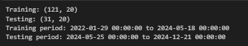

### Important: Leakage Prevention
*Context: Leakage is a term used to describe when information from the test set or future data accidentally makes its way into the training process, giving the model an unfair advantage and making its predictions look better than they actually are.*

Important here was to preserve the chronological order of the data and avoid data leakage. I trained the model on earlier weeks and reserved the later weeks for testing, rather than randomly shuffling the data.

*Note: The code snippets below are combined into one full script in my Jupyter Notebook. To run and test the complete workflow, simply run the notebook.*
```python
# Aggregate and sort data before splitting
weekly_data = (
    retail_sales.groupby('date')
    .agg({
        'weekly_sales': 'sum',
        'is_holiday': 'max',
        'temperature': 'mean'
    })
    .sort_index()
)

# Define X and y
feature_cols = [
    'sales_lag_1', 'sales_lag_2', 'sales_lag_3', 'sales_lag_4',
    'rolling_mean_4', 'rolling_std_4', 'rolling_max_4', 
    'is_holiday', 'week_sin', 'week_cos',
    'lag1_week_sin', 'lag1_week_cos',
    'momentum_week_sin', 'momentum_week_cos',
    'temperature'
] + holiday_dummies.columns.tolist()

weekly_data = weekly_data.dropna(subset=feature_cols)

X = weekly_data[feature_cols]
y = weekly_data['weekly_sales']

# Chronological 80/20 split
split_index = int(len(weekly_data) * 0.8)

X_train, X_test = X.iloc[:split_index], X.iloc[split_index:]
y_train, y_test = y.iloc[:split_index], y.iloc[split_index:]
```

## 8. Model Experimentation & Results

I ran two models to compare actual vs. predicted sales. As mentioned in the first objective, this model should aim to predict future demand for this retail sales company for the next 5-6 months. A good model should be able to capture both direction and volume of future demand on unforeseen data. 

The two models I ran the prediction experiments are:
1. **Linear Regression Model** - Uses coefficients to understand how each feature contributes to sales, combining these relationships to generate a forecast.

2. **XGBoost** - Builds multiple decision trees that learn from patterns in the data and adjust for previous prediction errors to improve the forecast.

The model with the more reliable predictions per our success metrics will be then chosen as our 'Champion Model' 

 Further analysis of the 'Champion Model' performance are the *features importance* and *residual errors* and will be in its corresponding sections below

--- 

### Measuring Model Succcess 
We will measure the success based on these performance metrics:

**1. Weighted Absolute Percentage Error (WAPE)** – Measures the overall prediction error relative to actual sales, giving us a better sense of how far off the model's forecasts are. <span style="color:green">*(e.g. WAPE = 4.5%)*</span>. The lower the better.

**2. Error Tolerance** – Measures the percentage of weekly predictions that fall within ±5% of actual sales. This helps determine how consistently the model gets close to the actual numbers. <span style="color:green">*(e.g. 85% of weeks within ±5%)*</span>. The higher the better.

**3. R² (Coefficient of Determination)** – Measures how much of the variation in actual weekly sales the model can explain. <span style="color:green">*(e.g. R² = 0.95)*</span>. The higher the better.

*Other supporting metrics include:*

**4. RMSE (Root Mean Squared Error)** – Measures prediction errors while placing more weight on larger misses, making it useful for identifying cases where the model significantly under- or overpredicts. <span style="color:green">*(e.g. RMSE = 1.3M)*</span>. The lower the better.

**5. MAE (Mean Absolute Error)** – Measures the average absolute difference between predicted and actual sales, giving us a straightforward view of how far off our predictions are. <span style="color:green">*(e.g. MAE = 1.0M)*</span>. The lower the better.

---- 
### Comparing the Two Models Score

Model A: Linear Regression
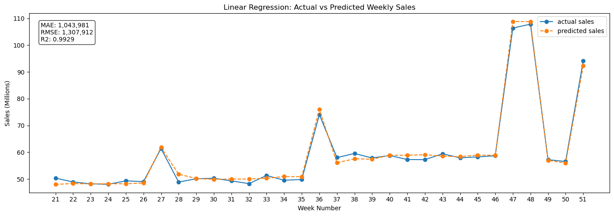

Model B: XGBoost
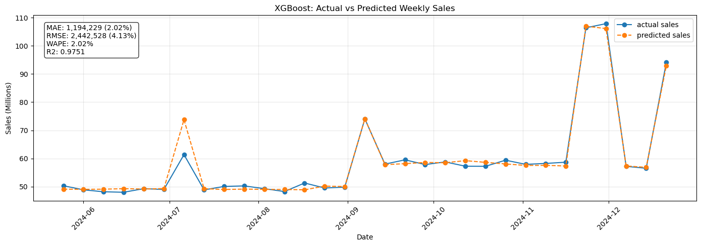


Both models provided excellent scores, both meeting the minimum performance success metrics. And visually both look similar. Here's an overlay view of predicted sales vs. actual sales

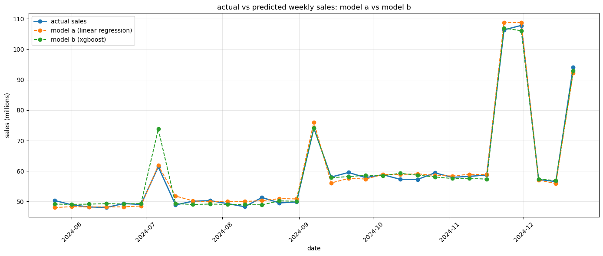

However comparing the 2 scores -- Model A exhibited better scores overall across all metrics -- making this our ***Champion Model*** !!
<table>
  <tr>
    <th>Metric</th>
    <th>Model A: Linear Regression</th>
    <th>Model B: XGBoost</th>
  </tr>
  <tr>
    <td>MAE</td>
    <td><span style="color:#90EE90">1,043,980.61</span></td>
    <td>1,194,228.55</td>
  </tr>
  <tr>
    <td>MAE %</td>
    <td><span style="color:#90EE90">1.77%</span></td>
    <td>2.02%</td>
  </tr>
  <tr>
    <td>RMSE</td>
    <td><span style="color:#90EE90">1,307,911.86</span></td>
    <td>2,442,527.64</td>
  </tr>
  <tr>
    <td>RMSE %</td>
    <td><span style="color:#90EE90">2.21%</span></td>
    <td>4.13%</td>
  </tr>
  <tr>
    <td>WAPE %</td>
    <td><span style="color:#90EE90">1.77%</span></td>
    <td>2.02%</td>
  </tr>
  <tr>
    <td>R²</td>
    <td><span style="color:#90EE90">0.99</span></td>
    <td>0.98</td>
  </tr>
</table>

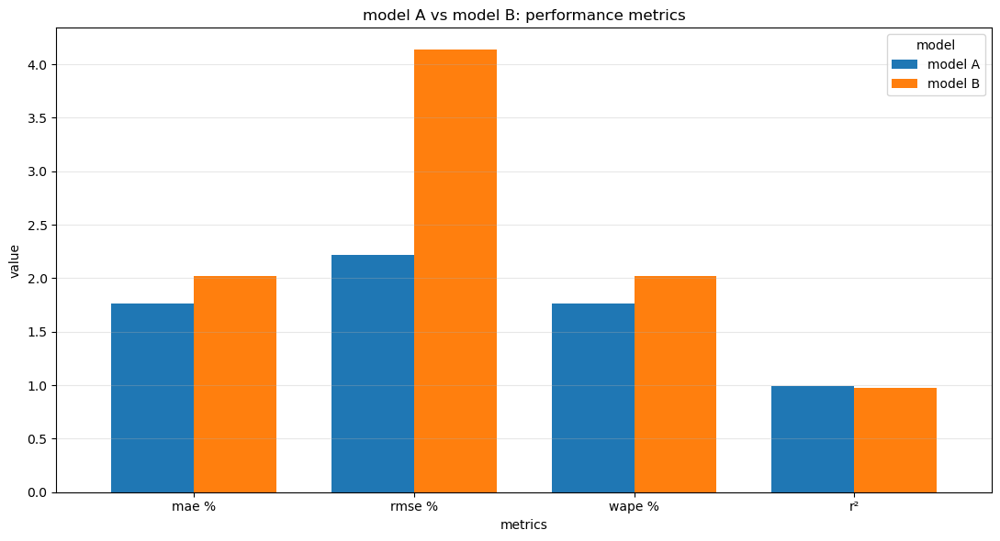

### Other predictive signals / features experimented, but didn't make the final list
Here are some features I experimented with that ended up reducing predictive performance. I took a guess at why they didn't work as well based on the results and patterns I observed.

*Note: These are just my best guesses and interpretations of the results, not definitive explanations.*

- **rolling_min_4** – I thought capturing the lowest sales in the past four weeks might help, but it didn't seem to add much beyond the other rolling features.
- **week_of_year, month, quarter** – My guess is that `week_sin` and `week_cos` did a better job of capturing seasonality than using calendar values directly.
- **sales_lag_52** – Last year's sales weren't always a reliable reference since weekly patterns didn't consistently repeat across years.
- **temp_change_1w** – The actual temperature seemed to provide more useful information than how much it changed from the previous week.
- **sales_change_1w** – My guess is that the raw change in sales wasn't as useful on its own, but combining momentum with seasonal features helped capture the pattern better.


## 9. Champion Model: Feature Importance
- Shows what features the model finds important and less important. Interpretation

## 10. Champion Model: Residual Analysis
- Reveal struggles in model

## 11. Business Interpretation and Insights
- These are the patterns i discovered in the data
- Why these features were important
- asdasd
